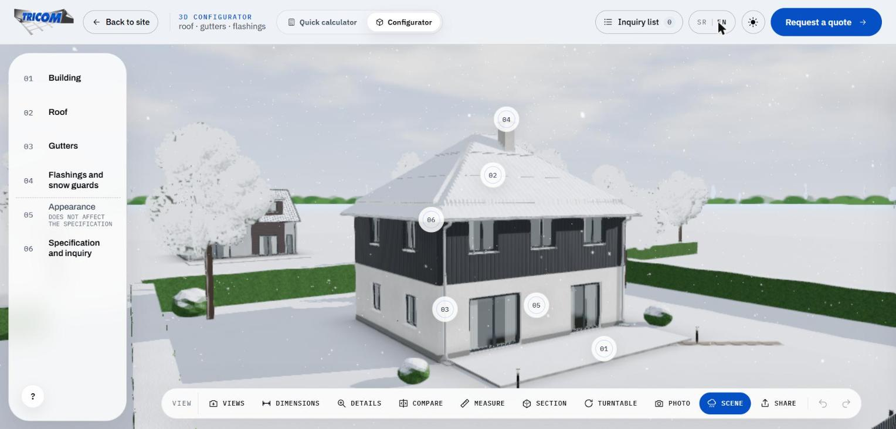
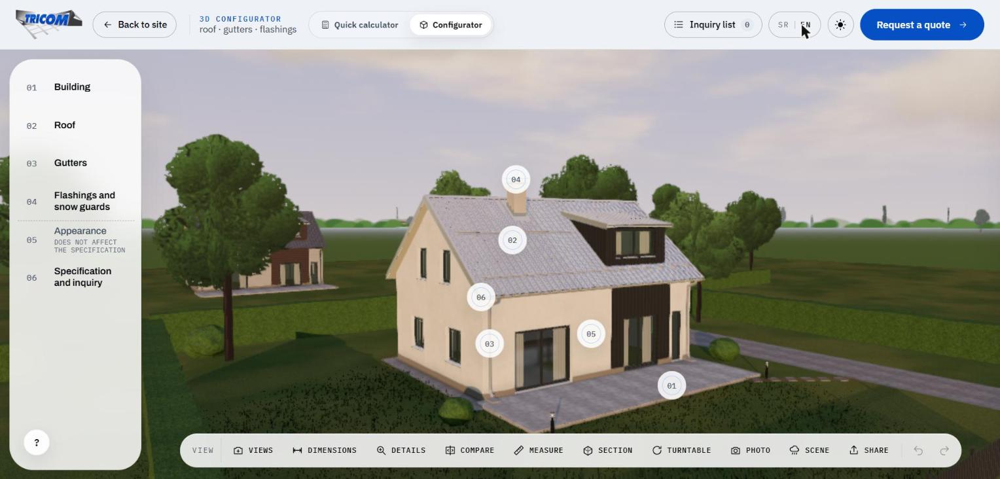
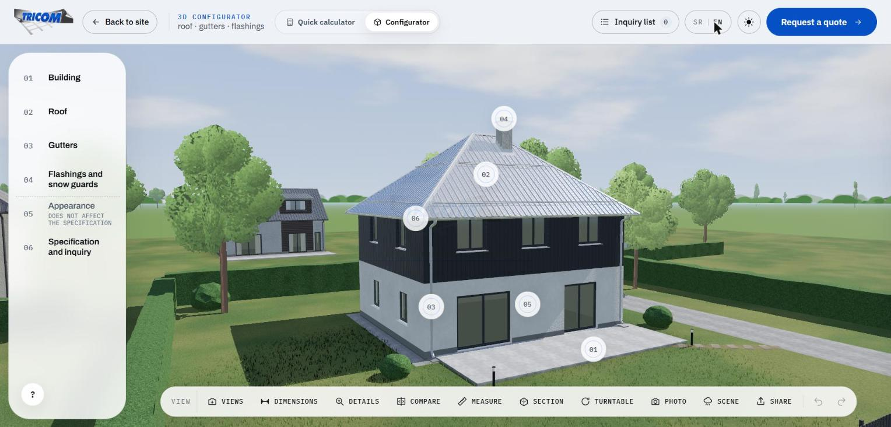
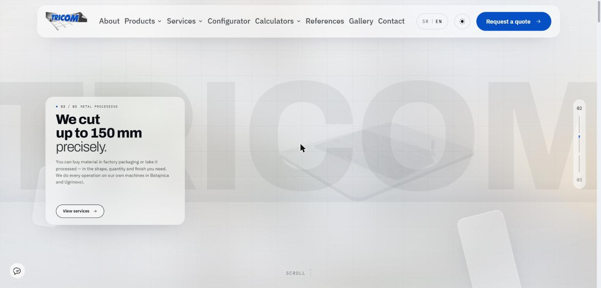

# Tricom: website + Three.js 3D roof configurator

A production website for **Tricom**, a Belgrade company that makes metal roofing, gutters and sheet metal and does metal processing. It is a bilingual (Serbian/English) PHP site with a custom CMS, five roofing calculators and an offline site assistant. Its centrepiece is a **real-time 3D roof & gutter configurator** written in vanilla JavaScript on **Three.js**. Customers design a building, see the exact roofing products on it in any weather and light, and get a bill of materials measured from the 3D model.

**Live:** [tricom.rs](https://tricom.rs/en/) · **[▶ Open the 3D configurator](https://tricom.rs/en/configurator.html)**



| Golden hour (sun position from time and date) | Hip roof, standing-seam sheet, anthracite façade zone |
|---|---|
|  |  |

---

## Highlights: the 3D configurator

The code is in [`js/konfigurator/`](js/konfigurator): ~6,900 lines across 12 modules, with no build step and no framework, on Three.js r147.

- **Parametric building generator** ([`k-house.js`](js/konfigurator/k-house.js), [`k-geo.js`](js/konfigurator/k-geo.js)). One code path builds all seven object types, from a gable house to an industrial hall. That includes walls with openings, roof planes skinned with the **true cross-section of each sheet profile**, and ridges, hips, valleys, verges and eaves. It also builds the tinsmith detail kit, gutters and downpipe runs. Dimensions are clamped to the real product ranges.
- **Bill of materials from the geometry** ([`k-spec.js`](js/konfigurator/k-spec.js)). Quantities are **measured from the model that is actually drawn** and combined with the catalogue rules, so the 3D view and the specification always agree. The result is spec tables, a print/PDF sheet and a ready-made inquiry. This also works on devices without WebGL, where the model is built but not rendered.
- **Lighting and environment** ([`k-env.js`](js/konfigurator/k-env.js), [`metal-env.js`](js/metal-env.js)):
  - a procedural sky dome with a sun disc, soft clouds, stars and drifting cloud billboards
  - sun and moon light driven by **time of day and date**, with soft shadows
  - **image-based lighting captured from the scene itself** (PMREM)
  - ACES tone mapping and physically based lights
  - night lamps and a dark "studio" cyclorama mode
- **Shader work.** Built-in Three.js materials are extended with **GLSL patches through `onBeforeCompile`**, for the roof, lawn blades, foliage and weather effects. Every texture is **generated at runtime on a canvas** ([`k-textures.js`](js/konfigurator/k-textures.js)), so the configurator makes no texture image requests at all. Materials are updated in place ([`k-materials.js`](js/konfigurator/k-materials.js)), so a colour change never rebuilds geometry.
- **Weather FX** ([`k-weather.js`](js/konfigurator/k-weather.js)):
  - **Rain** has instanced streaks around the camera, splash rings, water running in the gutters to the outlets, a jet from every downpipe, and overflow where a gutter run is overloaded.
  - **Winter** lays a snow blanket on each roof plane. The snow is held by the snow guards, or slides off in one sheet when there are none. There is also snow in the gutters and on the sills, and light snowfall.
- **Post-processing** ([`k-fx.js`](js/konfigurator/k-fx.js)):
  - a half-resolution **screen-space ambient occlusion** pass
  - a **photo mode** that renders an off-screen 4K frame from jittered samples, giving supersampling and depth of field at once, then adds vignette, grain and a letterbox
- **Performance for mobile:**
  - **render-on-demand**: a dirty flag plus a slow ambient tick for wind and clouds
  - **quality tiers** (high / medium / low) picked from CPU cores, pixel density, mobile UA and `prefers-reduced-motion`
  - **instanced meshes** for the treeline billboards, fences, pavers and repeated details
- **Interaction design** ([`k-ui.js`](js/konfigurator/k-ui.js), [`k-tools.js`](js/konfigurator/k-tools.js)):
  - a six-step flow, with a bottom sheet and tab bar on phones
  - hotspots on the model
  - **compare mode** with a split divider
  - a dimension overlay, detail inspector and **section view** (clipping plane with the labelled roof build-up)
  - a measure tool, sun-study replay, turntable/cinematic orbit and a guided tour
  - the full state kept in the **URL hash**, so every configuration is a shareable link

## Highlights: the home page 3D hero

[`js/hero3d.js`](js/hero3d.js) has three animated 3D scenes on the home page, sharing the renderer, studio environment and material factory with the configurator ([`js/metal-env.js`](js/metal-env.js)):

- **Sheet.** A roofing sheet slides in flat, and its ribs form from left to right in a **vertex shader**, followed by a light trail. Then the dimensions draw in.
- **Cut plate.** A plasma head traces the contour and every hole. The cut glows, sparks burst, and the cut-outs drop and fade.
- **Stack.** Twelve sheets in catalogue RAL colours land one by one, settle and kick up dust, and the steel straps tighten last.
- **Behaviour across all three:**
  - idle sway, a studio light sweep, and a parallax tilt towards the pointer
  - 600 ms cross-fades between scenes
  - particle systems created on entry and destroyed afterwards
  - static images on the low quality tier



## The website and CMS

- **Stack:** plain **PHP 8.3 + PDO + MySQL**, built for ordinary shared hosting with no server-side build, Node or SSH. Every public page is a PHP view, with Serbian and English versions.
- **Admin panel** ([`app/admin`](app/admin), [`admin/`](admin)):
  - **Content it manages:** products and categories, services, references, galleries, FAQ, contact data, opening hours and price-list inquiries.
  - **Security:** CSRF protection, rate-limited login (per IP and per user), and a one-time admin setup secret.
- **Quotes:** inquiries from the configurator and calculators become a **PDF quote plus an e-mail** (PHPMailer).
- **Roofing calculators:** five of them, written as pure functions with no DOM ([`js/calc.js`](js/calc.js)), so they can be tested in Node.
- **Offline site assistant** ([`js/assistant.js`](js/assistant.js)). It searches a knowledge base with Cyrillic → Latin normalisation and phrase and word scoring. When nothing matches well it falls back honestly to the contact details, with no external API.
- **Migration tooling** ([`_tools/`](_tools)): Node scripts that converted the old static site into structured database content. The old site's HTML is not included.

## Tech stack

`Three.js (r147)` · `GLSL (onBeforeCompile patches)` · `vanilla JavaScript` · `HTML / CSS` · `PHP 8.3` · `MySQL / PDO` · `PHPMailer` · `Node.js (tooling)`

About **19k lines of JavaScript**, **20k lines of PHP** and **10k lines of CSS**, not counting vendored libraries.

## Project structure

```
js/konfigurator/   3D configurator modules (k-app, k-house, k-geo, k-env, k-materials,
                   k-textures, k-weather, k-fx, k-tools, k-ui, k-spec, k-data)
js/hero3d.js       home page / sub-page 3D hero scenes
js/metal-env.js    shared renderer, PMREM studio environment, metal material factory, quality tier
js/catalog.js      product catalogue + calculation rules (shared by the calculators, configurator and spec)
app/               PHP back end: lib (auth, CSRF, DB, mailer, quote PDF), admin modules, site controllers, views
admin/             admin entry points (login, setup)
database/          schema, existing content and incremental patches
en/                English routes
_tools/            content-migration scripts
docs/              implementation record, deployment guide (SR), original README (SR)
```

## Running it

Any Apache + PHP 8.3 + MySQL host works:

1. Copy `app/config.example.php` to `app/config.php` and fill in your database and mail settings.
2. Import `database/001-schema.sql`, then `002-existing-content.sql`, then `database/patches/*` in order.
3. Open `/admin/setup-admin.php` to create the admin account.

The full step-by-step guide is in [`docs/DEPLOYMENT.sr.md`](docs/DEPLOYMENT.sr.md) (Serbian), and the engineering log is in [`docs/IMPLEMENTATION.md`](docs/IMPLEMENTATION.md).

## Notes

- This is client work. The brand, content and product photos belong to Tricom, and the code is mine. Live credentials are **not** in this repository; only `config.example.php` with placeholders is.
- I built it with an AI-assisted workflow (Claude Code). I designed it, directed the work, reviewed and tested it, and shipped it.

---

Made by **Stefan Ristić**, [esardev.in.rs](https://esardev.in.rs)
